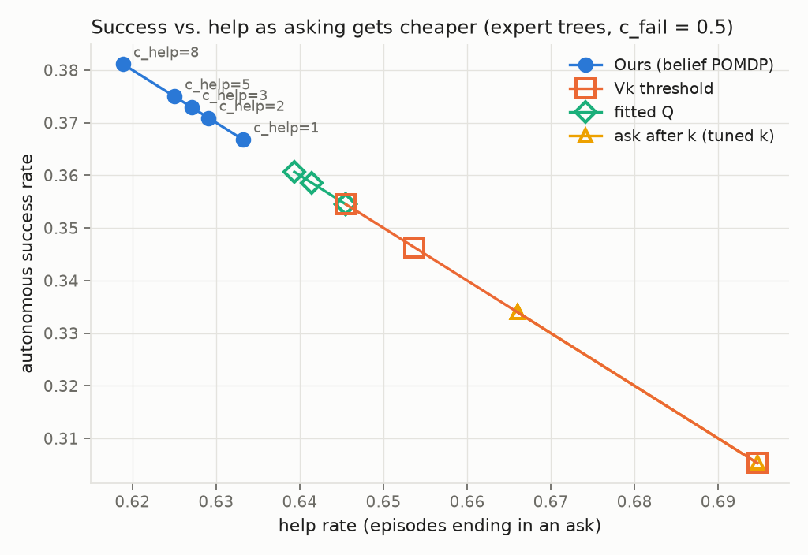
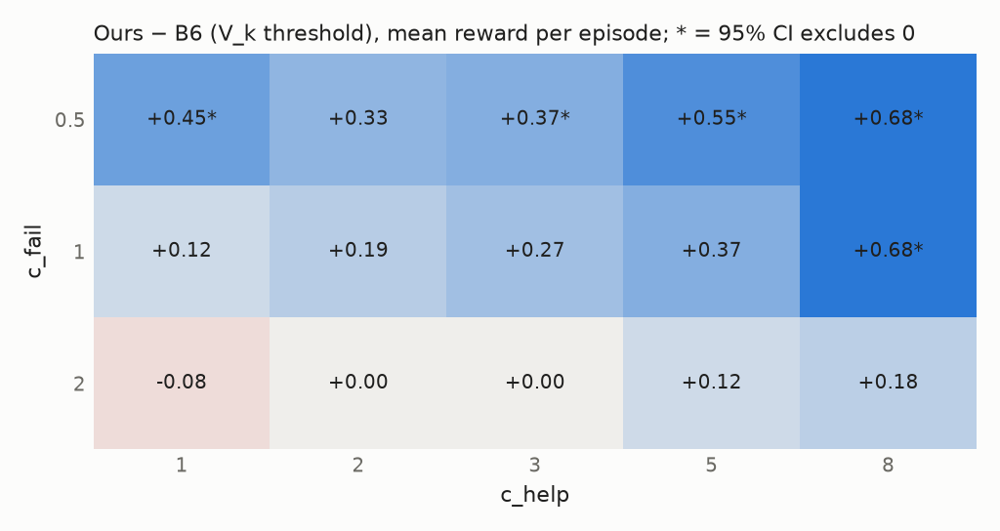
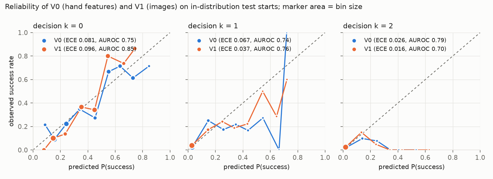
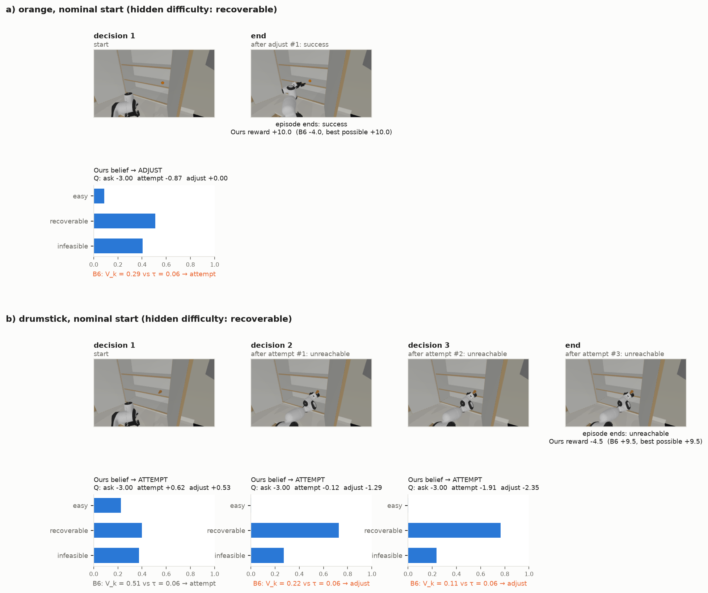

# When Should a Robot Ask for Help?

**CS 238 final project, draft 1 (2026-11-28).** TODO: authors; course format and page limit (unknown, check the
course page). Every number below comes from `reports/help_eval/*/summary.md`, which `scripts/help_eval.py`
regenerates; the expert results were re-run on 2026-11-28 and reproduced exactly.

## Abstract

A robot that fails a manipulation task can keep trying, change its approach, or ask a person for help. Asking costs
the person's time; trying again costs time and risks making things worse. We frame this as a POMDP whose hidden state
is how hard the task really is (easy, recoverable, or infeasible), and compare ways of choosing between *attempt*,
*adjust* and *ask* over up to three attempts. On 488 held-out shelf pick-and-place starts in simulation, a belief-state
planner with a learned difficulty prior earns 1.37 reward per episode, against 0.60 for never asking, −3.00 for always
asking, 0.59 for asking after two failures, and 1.00 for thresholding a learned success predictor (the main baseline).
The gain over the success predictor is borderline (+0.37, 95% CI [0.00, 0.75]). Ablations show it comes from the
learned start-state prior and from choosing *how* to retry, not from planning ahead. Letting the observation model
depend on the previous failure (a post-hoc ablation) makes the gain over the success predictor clear: +0.40
[0.04, 0.78] at the default costs, and significant in 14 of 15 cost settings.

## 1. Introduction

TODO (team): motivation in two paragraphs. A home robot will fail often; a person nearby can fix most failures
quickly; asking too often makes the robot useless, asking too rarely wastes time and can damage things. The decision
depends on something the robot cannot see directly: whether another try is likely to work.

Contributions:

1. A small decision problem for help-seeking: three hidden difficulty levels, three actions, explicit costs, a horizon
   of three attempts.
2. A dataset of *counterfactual trees*: every start state is played out under every action sequence, so any help
   policy can be scored exactly offline, with no simulator in the loop.
3. A comparison of simple rules, learned success predictors, an offline RL policy, and a belief-state POMDP planner,
   with paired confidence intervals over a grid of help and failure costs.

## 2. Related work

TODO (team): cite real papers only. Topics to cover: learning when to ask for help / requesting assistance
(e.g. confidence-based autonomy, conformal prediction for asking, "KnowNo"); success detection and value functions for
robot policies; POMDPs and QMDP; offline RL and fitted Q-iteration; vision-language-action policies (pi0 / pi0.5).

## 3. Problem formulation

**Episode.** The robot faces one start state (object, pose, shelf target). Before each attempt k = 0, 1, 2 it chooses:

- **attempt (A):** run the default grasp-and-place again;
- **adjust (D):** run a different approach (a swung, offset re-approach);
- **ask:** a person finishes the task and the episode ends.

**Reward.** +10 if the robot succeeds by itself; −c_help for asking; −c_fail for each failed attempt; −5 more if the
object is knocked off the shelf. Knocking it off, missing the placement, or failing a third time forces an ask.
Defaults: c_help = 3, c_fail = 0.5. We also sweep c_help ∈ {1, 2, 3, 5, 8} × c_fail ∈ {0.5, 1, 2}.

**Hidden state.** Difficulty d ∈ {easy, recoverable, infeasible}: *easy* if the first default attempt succeeds,
*recoverable* if some later action sequence succeeds, *infeasible* if none does within three attempts. The label is
defined by outcomes, so it is known for training data but never observed by a policy.

**Observations.** After each attempt the robot sees its outcome: success, unreachable, grasp miss, slip, place miss or
off the shelf, plus the robot and object state and camera frames.

This is a finite-horizon POMDP with |S| = 3 hidden difficulties × attempt count, |A| = 3, and 6 observation symbols.

## 4. Tasks and data

**Shelf pick-and-place (main task).** A Franka arm (DROID setup) in a MuJoCo twin of a real kitchen picks an object off
a shelf and places it at a target. A scripted expert does the grasping, so the help decision is studied separately from
the low-level policy. Failures come from the scene itself and from injected faults: *nominal*, *pose error*,
*place error* and *weak grip*. Training objects: banana, drumstick, duster, egg, sponge, tape, tomato, waffle, wooden
ball. Held out: the **orange** (similar to the training objects) and the **metal spoon** (hard, almost always
infeasible).

**Counterfactual trees.** From every start we play out *every* action sequence up to three attempts (both A and D at
every node) and record outcomes and frames at each node. A help policy then only chooses a path through the tree, and
its reward is computed exactly. There are 1,265 trees (start × fault condition). Starts of training objects are split
60/15/25 into train/calibration/test by start, so a start never appears in two splits; held-out objects are test only.
The test set has 488 trees: 149 easy, 99 recoverable, 240 infeasible.

**Drawer opening (second task).** A mobile manipulator pulls a drawer open, with up to three pulls per episode; faults
include stuck, locked, hard and weak grip. These are logged runs (one path per episode), not full trees. 67 test
episodes.

**Learned low-level policy (pi0.5).** We fine-tuned pi0.5 with LoRA on scripted demonstrations for both tasks (shelf:
7,000 steps; drawer: 5,000 steps). The drawer policy opens the drawer in 8 of 9 nominal checks; the shelf policy
succeeds in only 5 of 30 episodes. We use these runs to show that the help pipeline works on a learned policy (§7.4),
not to rank methods.

## 5. Methods

All learned components are fit on the training split; thresholds, k, and calibration are tuned on the calibration split
separately for each cost setting; everything is scored on the test split.

**Simple baselines.**

- **B1 never ask:** always continue (attempt first, then adjust).
- **B2 always ask:** ask immediately.
- **B3 ask after k failures:** k tuned on calibration (k = 2 at default costs).
- **B4 random:** ask at random, at the same rate as Ours.

**Success predictors (value functions).** V_k = P(success if the robot keeps going without asking | what it has seen
so far), recomputed before every attempt.

- **V0:** logistic regression on hand-built features: object size, mass and friction, start and target position, the
  attempt count, the past failure types, the last failure's phase, and how far the object has moved. Platt-scaled on the
  calibration split.
- **V1:** a 5-member MLP ensemble on frozen DINOv2 ViT-S/14 embeddings of the two cameras plus proprioception and
  history, Platt-scaled.

**Value-function policies.**

- **B5:** threshold V0 once at the start, then never ask.
- **B6 (main baseline):** before every attempt, ask if V_k < τ, otherwise continue. This is the proposal's "learned
  success predictor" approach. B6′ uses V1.
- **B7 myopic expected utility:** continue iff 10·V − c_fail·(1 − V) > −c_help. At the default costs this never asks,
  because it only looks one attempt ahead.

**B9 offline RL (fitted Q-iteration).** Q_k(x, a) for k = 2, 1, 0 by ridge regression on the training trees'
transitions, using the same features as V0; Q(ask) = −c_help. This is our "help policy trained with RL".

**Ours: belief POMDP.**

1. *Prior:* a multinomial logistic regression on the start state's features predicts P(d) (the *difficulty head*).
2. *Observation model:* P(outcome | d, action, k) is counted from the training trees, with additive smoothing.
3. *Belief update:* Bayes' rule after each attempt.
4. *Planning:* exact value iteration over the belief, for the remaining attempts, over {attempt, adjust, ask}.

**B8 QMDP** uses the same belief but assumes the difficulty becomes known after one step.

**Oracles.** **O1** knows the true difficulty (one-hot prior). **O2** knows every outcome in the tree (the best any
policy can do).

**Ablations.** A1 uniform prior; A2 training-frequency prior (same for every start); A3 outcomes collapsed to
success/failure; A4 no adjust action; A5 prior from images instead of features; A7 observation model that also
conditions on the previous attempt's outcome (§6.5).

**Statistics.** Mean reward per episode with 95% bootstrap CIs (10,000 resamples); differences between methods are
paired by test start.

## 6. Results

### 6.1 Main result: shelf, scripted expert, default costs

| Method | Reward (95% CI) | Success | Asks | Failed attempts / ep | Ours − method (95% CI) |
|---|---|---|---|---|---|
| O2 clairvoyant | 3.49 [2.93, 4.06] | | | | |
| O1 difficulty oracle | 2.43 [1.85, 3.00] | 0.43 | 0.57 | 0.33 | |
| **Ours (belief POMDP)** | **1.37 [0.79, 1.97]** | 0.37 | 0.63 | 0.83 | — |
| B8 QMDP | 1.38 [0.79, 1.99] | 0.38 | 0.62 | 0.88 | −0.01 [−0.14, +0.12] |
| **B6 V_k threshold** | **1.00 [0.42, 1.59]** | 0.35 | 0.65 | 0.84 | +0.37 [+0.00, +0.75] |
| B5 V0 at start only | 0.99 [0.43, 1.56] | 0.34 | 0.66 | 0.76 | +0.38 [−0.03, +0.80] |
| B9 fitted Q (RL) | 0.93 [0.33, 1.54] | 0.35 | 0.65 | 1.21 | +0.44 [+0.21, +0.67] |
| B6′ V1 threshold (images) | 0.76 [0.20, 1.32] | 0.31 | 0.69 | 0.56 | +0.61 [+0.30, +0.94] |
| B1 never ask | 0.60 [−0.02, 1.22] | 0.36 | 0.64 | 1.89 | +0.77 [+0.37, +1.17] |
| B7 myopic EU | 0.60 [−0.01, 1.23] | 0.36 | 0.64 | 1.89 | +0.77 [+0.37, +1.16] |
| B3 ask after 2 failures | 0.59 [0.01, 1.18] | 0.33 | 0.67 | 1.32 | +0.78 [+0.44, +1.14] |
| B4 random | −0.28 [−0.73, 0.19] | 0.26 | 0.74 | 1.15 | +1.65 [+1.31, +1.99] |
| B2 always ask | −3.00 | 0.00 | 1.00 | 0.00 | +4.37 [+3.79, +4.96] |

"Asks" counts forced asks too (after a third failure or a terminal failure). Half the test starts are infeasible, so
every method must ask often; what separates them is how many failed attempts they spend before asking, and whether they
find the success on recoverable starts.

**C1: a learned predictor beats the simple rules.** Holds. B6 (1.00) and Ours (1.37) both beat never asking (0.60),
always asking (−3.00) and asking after two failures (0.59). Ours beats never asking by +0.77 [0.37, 1.17]. Ours gets
almost the same success rate as never asking (0.37 vs 0.36) with less than half the failed attempts (0.83 vs 1.89).

**C2: a structured belief beats thresholding the value function.** Borderline. Ours − B6 = +0.37 [0.00, 0.75] at the
default costs. Over the 15 cost settings the CI excludes zero in 5 (four of them with the cheapest failure cost,
c_fail = 0.5, and two with the highest help cost, c_help = 8) and Ours is never significantly worse than B6 (Figure 2).

**C3: offline RL.** Fitted Q-iteration (0.93) beats the simple rules but not Ours (+0.44 [0.21, 0.67] for Ours), even
though it sees the same features and the same training trees.



*Figure 1. Success rate against help rate as the help cost varies. TODO: one-sentence takeaway once the team has
looked at it.*



*Figure 2. Ours − B6 reward over the cost grid, with 95% paired CIs.*

### 6.2 Where the gain comes from (ablations)

| Variant | Reward | Ours − variant (95% CI) |
|---|---|---|
| Ours | 1.37 | — |
| B8 QMDP (no information-gathering lookahead) | 1.38 | −0.01 [−0.14, +0.12] |
| A7 + previous outcome (§6.5) | 1.40 | −0.03 [−0.28, +0.22] |
| A3 success/failure only (no failure types) | 1.37 | −0.00 [−0.16, +0.15] |
| A5 image prior instead of feature prior | 1.12 | +0.25 [+0.00, +0.51] |
| A4 no adjust action | 0.56 | +0.81 [+0.52, +1.12] |
| A1 uniform prior | 0.23 | +1.14 [+0.84, +1.45] |
| A2 frequency prior (same for every start) | 0.19 | +1.19 [+0.89, +1.50] |

- **The start-state prior matters most.** Without a per-start prior (A1, A2) Ours falls below never asking.
- **Choosing how to retry matters.** Without the adjust action (A4) the reward drops by 0.81.
- **Lookahead and failure types do not.** QMDP and the success/failure-only model tie Ours.

So the honest headline is *"a learned prior plus Bayes updates over difficulty, with a choice of retry strategy, beats
thresholding a success predictor"*, not *"planning ahead helps"*.

### 6.3 The success predictors

| Predictor | Split | AUROC before attempt 1 | before attempt 2 | before attempt 3 |
|---|---|---|---|---|
| V0 (features) | in distribution | 0.75 | 0.74 | 0.79 |
| V1 (images) | in distribution | 0.85 | 0.77 | 0.70 |
| V0 | orange (held out) | 0.74 | 0.69 | 0.75 |
| V1 | orange (held out) | 0.73 | 0.65 | 0.62 |

V1 ranks starts better than V0 before the first attempt (0.85 vs 0.75), but B6′ with V1 earns less than B6 with V0
(0.76 vs 1.00): it asks more often (voluntary ask rate 0.63 vs 0.51). On the orange, both predictors are badly
over-confident about failure: the true success rate before the first attempt is 0.67, and V0's calibration error is
0.37 (Figure 4). The difficulty head is 64% accurate in distribution but only 17% on the orange, which it mostly calls
infeasible.



*Figure 4. Reliability diagrams for V0 and V1 on the test split.*

### 6.4 An example episode, and a failure mode



*Figure 3. Two test starts played by Ours (frames, belief, Q values) with B6's decision at the same points.*

(a) On a recoverable orange start, Ours's prior is split between recoverable and infeasible, and the planner prefers
to *adjust* first. The adjusted approach succeeds (+10). B6 sees V_k = 0.29 > τ, attempts the default grasp, fails,
adjusts, fails, and ends up asking (−4).

(b) On a recoverable drumstick start, the default grasp is *unreachable*. Ours's belief moves toward "recoverable",
but it keeps choosing *attempt*, repeating the same unreachable grasp three times (−4.5). B6, which continues by
adjusting after a failure, succeeds on its second try (+9.5).

The reason is a modelling choice. Ours's observation model P(outcome | d, a, k) does not depend on *which* failure
came before. In training, after an unreachable first attempt on a recoverable start, adjusting succeeds 8 of 71 times
and repeating succeeds 1 of 71. But averaged over all histories, the model estimates P(success | recoverable, second
attempt) at 0.29 for repeating and 0.15 for adjusting, so it repeats. This also explains why failure types do not help
in the A3 ablation: they update the belief about difficulty, but never inform which retry to choose.

### 6.5 Fixing it: conditioning on the previous outcome (A7)

A7 replaces P(o | d, a, k) with P(o | d, a, k, o_prev), where o_prev is the previous attempt's outcome. To cope with
sparse histories, each conditional distribution is shrunk toward the pooled one with a pseudo-count strength tuned on
the calibration split (from {0.5, 1, 2, 5, 10, 25}; 0.5 is chosen in 13 of 15 settings). Belief updates and planning
carry o_prev along; nothing else changes.

| c_help, c_fail | A7 | A7 − Ours (95% CI) | A7 − B6 (95% CI) |
|---|---|---|---|
| 3, 0.5 (default) | 1.40 | +0.03 [−0.22, +0.28] | **+0.40 [+0.04, +0.78]** |
| 3, 1 | 1.06 | +0.25 [+0.06, +0.47] | +0.52 [+0.20, +0.86] |
| 3, 2 | 0.51 | +0.37 [+0.21, +0.56] | +0.37 [+0.06, +0.69] |
| 8, 2 | −2.56 | +0.60 [+0.32, +0.92] | +0.78 [+0.35, +1.23] |

Over all 15 cost settings (full table in `reports/help_eval/expert/summary.md`):

- **A7 beats B6 in 14 of 15**, with the CI excluding zero (the exception is c_help = 1, c_fail = 2: +0.20
  [−0.06, +0.45]). This turns C2 from borderline into a clear result.
- **A7 beats Ours in 8 of 15** and is never significantly worse. Its gains come at higher failure costs: at
  c_fail = 0.5 it ties Ours.
- At the default costs, A7 acts differently from Ours on 86 of 488 test starts. It earns more on 21 (16 of them
  recoverable: it finds the adjust that works) and less on 35 (19 infeasible, 10 easy, 6 recoverable). Counting
  successes: A7 wins 11 that Ours loses and loses 9 that Ours wins; most other differences are one failed attempt
  (±0.5). The net is a tie.
- It does not rescue the drumstick episode in Figure 3b: it adjusts first, fails, and asks (−3.5 instead of −4.5).

**Caveat.** We designed A7 after looking at a test episode (Figure 3b). The evidence that motivates it (adjust 8/71
vs. repeat 1/71 after "unreachable") is from the training split, and its one hyperparameter is tuned on calibration,
but the choice to try it was informed by the test set. Report it as a post-hoc ablation, not as the pre-registered
main method.

### 6.6 Robustness across costs

TODO (team): two or three sentences from the second table of `reports/help_eval/expert/summary.md`. Points to make:
QMDP is the best other method in 14 of 15 settings and ties Ours within ±0.04 in most; Ours is significantly worse than
the best other method in two settings, both with c_fail = 2: B6′ at c_help = 1 (−0.25 [−0.47, −0.02]) and QMDP at
c_help = 3 (−0.23 [−0.41, −0.07]).

## 7. Second task and the learned policy

### 7.1 Drawer, scripted planner

Every method except always ask and ask-after-k is within 0.4 reward of the clairvoyant (Ours 5.87, B6 5.80, never ask
5.78, clairvoyant 6.18), so this task cannot separate the methods. Ours beats never asking by a small but
significant +0.09 [+0.04, +0.14].

### 7.2 pi0.5 on the drawer

29 test episodes. At the default costs every learned method, Ours included, behaves like never asking (6.22), because
the drawer policy usually succeeds on a re-pull. Asking after two failures is much worse (4.55; Ours − B3 =
+1.67 [+0.28, +3.48]). With c_fail = 2, Ours and QMDP beat never asking by +0.21 [0.00, 0.41].

### 7.3 pi0.5 on the shelf

21 test starts, 17 of them infeasible, because the fine-tuned shelf policy rarely succeeds. Here the belief planner
does badly: it asks at almost every start, but about half the time only after a failed attempt (−3.24), while asking right away gives −3.00
and fitted Q gives −2.19. With this few successes, neither the prior nor the observation model can be trained well.

### 7.4 Takeaway

The pipeline runs end to end on a learned VLA policy: collect trees, fit the predictors, score every method. With 21–29
test episodes, the results are too noisy to rank methods.

## 8. Limitations

- The main result uses a scripted expert, not a learned policy; the pi0.5 shelf policy was too weak to supply a
  comparable dataset.
- Difficulty labels are defined by outcomes within three attempts.
- Simulation only. The kitchen asset set has no cups; held-out generalisation is tested with the orange and the metal
  spoon only.
- Scoring is offline on trees. We did not run the policies closed-loop on fresh starts (optional check, see the plan).
- Ours's observation model ignores the previous failure type when choosing the next action (§6.4). A7 fixes this,
  but it was designed after looking at a test episode (§6.5).
- The help cost is a constant; a real person's cost depends on context.

## 9. Conclusion and future work

TODO (team): two short paragraphs. Future work: confirm A7 on fresh starts collected after this analysis, and
condition on longer histories (the previous action as well as its outcome); an INSPECT action that gathers information before acting; closed-loop and real-robot
evaluation; more pi0.5 data so the learned-policy results can rank methods.

## Appendix: reproducing the numbers

```bash
source env.sh
$PY scripts/help_eval.py --trees data/shelf_pnp/20261114_tree --family expert --out reports/help_eval/expert
$PY scripts/example_episode.py --trees data/shelf_pnp/20261114_tree --out reports/help_eval/expert \
    --key expert/nominal/orange/29008 --key expert/nominal/drumstick/22006
```

Data and checkpoints: the team Drive folder (see the team handoff doc). The evaluation needs only numpy, scipy and
matplotlib, plus the trees.
