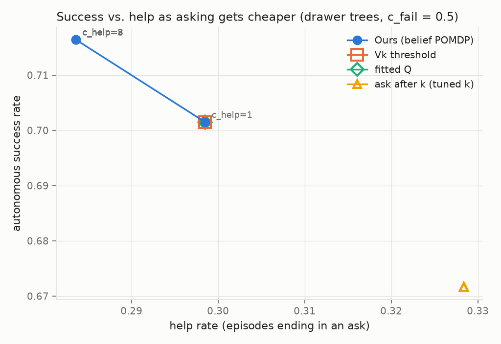
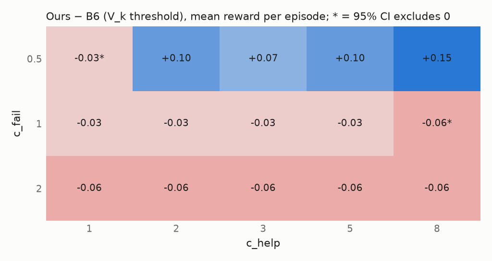
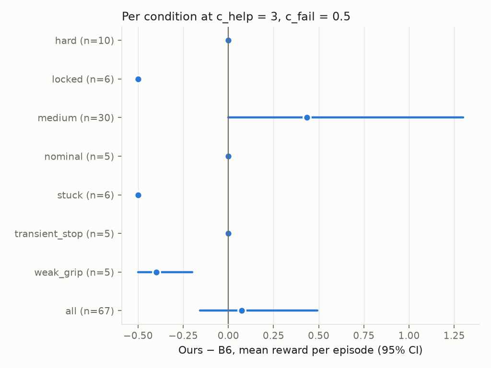

# Help-policy evaluation: drawer trees

Folds (starts x conditions): {'train': 90, 'cal': 23, 'test': 67}. Test groups: {'hard': 10, 'locked': 6, 'medium': 30, 'nominal': 5, 'stuck': 6, 'transient_stop': 5, 'weak_grip': 5}. Test difficulty: {'easy': 33, 'recoverable': 15, 'infeasible': 19}.

## Default costs (c_help = 3, c_fail = 0.5)

Tuned on cal: {'tau_B6': 0.16, 'tau_B5': 0.0, 'k_B3': 2, 'q_B4': 0.09523809523809523}

| method | reward (95% CI) | success | help | voluntary ask | fails/ep | off shelf | vol. ask prec. | vol. ask recall | regret | Ours − method (95% CI) |
|---|---|---|---|---|---|---|---|---|---|---|
| O1 difficulty oracle | 6.18 [4.82, 7.52] | 0.72 | 0.28 | 0.28 | 0.27 | 0.000 | 1.00 | 1.00 | 0.00 | -0.31 [-0.43, -0.19] |
| O2 clairvoyant | 6.18 [4.78, 7.52] | | | | | | | | 0 | -0.31 [-0.43, -0.19] |
| B8 QMDP | 5.87 [4.39, 7.34] | 0.72 | 0.28 | 0.18 | 0.88 | 0.000 | 1.00 | 0.63 | 0.31 | +0.00 [+0.00, +0.00] |
| Ours belief POMDP | 5.87 [4.38, 7.32] | 0.72 | 0.28 | 0.18 | 0.88 | 0.000 | 1.00 | 0.63 | 0.31 | — |
| A1 Ours, uniform prior | 5.87 [4.25, 7.34] | 0.72 | 0.28 | 0.18 | 0.88 | 0.000 | 1.00 | 0.63 | 0.31 | +0.00 [+0.00, +0.00] |
| A2 Ours, frequency prior | 5.87 [4.39, 7.34] | 0.72 | 0.28 | 0.18 | 0.88 | 0.000 | 1.00 | 0.63 | 0.31 | +0.00 [+0.00, +0.00] |
| B6 Vk threshold | 5.80 [4.25, 7.22] | 0.70 | 0.30 | 0.25 | 0.64 | 0.000 | 0.94 | 0.84 | 0.38 | +0.07 [-0.16, +0.49] |
| B1 never ask | 5.78 [4.21, 7.27] | 0.72 | 0.28 | 0.00 | 1.06 | 0.000 | 0.00 | 0.00 | 0.40 | +0.09 [+0.04, +0.14] |
| B5 V0 threshold | 5.78 [4.25, 7.27] | 0.72 | 0.28 | 0.00 | 1.06 | 0.000 | 0.00 | 0.00 | 0.40 | +0.09 [+0.04, +0.13] |
| B7 myopic EU | 5.78 [4.23, 7.28] | 0.72 | 0.28 | 0.00 | 1.06 | 0.000 | 0.00 | 0.00 | 0.40 | +0.09 [+0.04, +0.13] |
| A3 Ours, success/failure only | 5.78 [4.25, 7.26] | 0.72 | 0.28 | 0.00 | 1.06 | 0.000 | 0.00 | 0.00 | 0.40 | +0.09 [+0.04, +0.13] |
| B9 fitted Q | 5.77 [4.31, 7.20] | 0.70 | 0.30 | 0.19 | 0.70 | 0.000 | 0.92 | 0.63 | 0.41 | +0.10 [-0.13, +0.52] |
| B3 ask after k=2 | 5.31 [3.67, 6.79] | 0.67 | 0.33 | 0.27 | 0.84 | 0.000 | 0.83 | 0.79 | 0.87 | +0.56 [-0.02, +1.34] |
| B4 random at Ours's help rate | 4.67 [3.33, 5.98] | 0.62 | 0.38 | 0.16 | 0.90 | 0.000 | 0.42 | 0.24 | 1.51 | +1.20 [+0.94, +1.47] |
| B2 always ask | -3.00 [-3.00, -3.00] | 0.00 | 1.00 | 1.00 | 0.00 | 0.000 | 0.28 | 1.00 | 9.18 | +8.87 [+7.38, +10.33] |

## Ours − B6 (V_k threshold) and Ours − best other non-oracle method, over the cost grid

| c_help | c_fail | Ours | B6 | Ours − B6 (95% CI) | best other | Ours − best other (95% CI) |
|---|---|---|---|---|---|---|
| 1 | 0.5 | 6.37 | 6.40 | -0.03 [-0.06, -0.01] | B8 QMDP (6.49) | -0.12 [-0.47, +0.07] |
| 1 | 1 | 6.04 | 6.07 | -0.03 [-0.07, +0.00] | B6 Vk threshold (6.07) | -0.03 [-0.07, +0.00] |
| 1 | 2 | 5.37 | 5.43 | -0.06 [-0.15, +0.00] | B6 Vk threshold (5.43) | -0.06 [-0.15, +0.00] |
| 2 | 0.5 | 6.20 | 6.10 | +0.10 [-0.11, +0.49] | B8 QMDP (6.16) | +0.04 [+0.01, +0.08] |
| 2 | 1 | 5.75 | 5.78 | -0.03 [-0.07, +0.00] | B6 Vk threshold (5.78) | -0.03 [-0.07, +0.00] |
| 2 | 2 | 5.07 | 5.13 | -0.06 [-0.15, +0.00] | B6 Vk threshold (5.13) | -0.06 [-0.15, +0.00] |
| 3 | 0.5 | 5.87 | 5.80 | +0.07 [-0.16, +0.49] | B8 QMDP (5.87) | +0.00 [+0.00, +0.00] |
| 3 | 1 | 5.45 | 5.48 | -0.03 [-0.07, +0.00] | B6 Vk threshold (5.48) | -0.03 [-0.07, +0.00] |
| 3 | 2 | 4.78 | 4.84 | -0.06 [-0.15, +0.00] | B6 Vk threshold (4.84) | -0.06 [-0.15, +0.00] |
| 5 | 0.5 | 5.31 | 5.20 | +0.10 [-0.16, +0.58] | B8 QMDP (5.31) | +0.00 [+0.00, +0.00] |
| 5 | 1 | 4.85 | 4.88 | -0.03 [-0.07, +0.00] | B6 Vk threshold (4.88) | -0.03 [-0.07, +0.00] |
| 5 | 2 | 4.18 | 4.24 | -0.06 [-0.15, +0.00] | B6 Vk threshold (4.24) | -0.06 [-0.15, +0.00] |
| 8 | 0.5 | 4.46 | 4.31 | +0.15 [-0.16, +0.72] | B8 QMDP (4.46) | +0.00 [+0.00, +0.00] |
| 8 | 1 | 3.93 | 3.99 | -0.06 [-0.12, -0.01] | B6 Vk threshold (3.99) | -0.06 [-0.12, -0.01] |
| 8 | 2 | 3.28 | 3.34 | -0.06 [-0.15, +0.00] | B6 Vk threshold (3.34) | -0.06 [-0.15, +0.00] |

## Predictors on test (V_k: P(success | the default continuation); V0 hand features, V1 DINOv2 frames + proprioception + history)

| predictor | n | base rate | AUROC | Brier | NLL | ECE |
|---|---|---|---|---|---|---|
| V0/in_distribution/k0 | 37 | 0.49 | 0.500 | 0.250 | 0.694 | 0.025 |
| V0/in_distribution/k1 | 26 | 0.27 | 0.985 | 0.052 | 0.160 | 0.047 |
| V0/in_distribution/k2 | 20 | 0.05 | 0.895 | 0.038 | 0.115 | 0.011 |

| difficulty head | n | accuracy | NLL | mean prior (easy, recoverable, infeasible) | true mix |
|---|---|---|---|---|---|
| difficulty/in_distribution | 37 | 0.51 | 1.026 | [0.356, 0.178, 0.467] | [0.297, 0.189, 0.514] |

