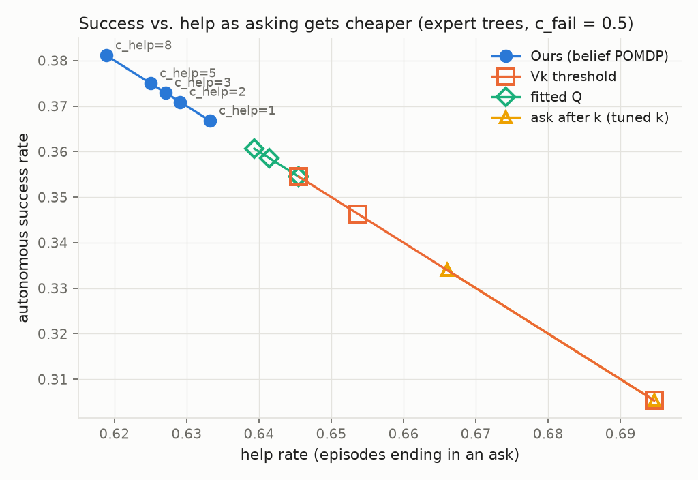
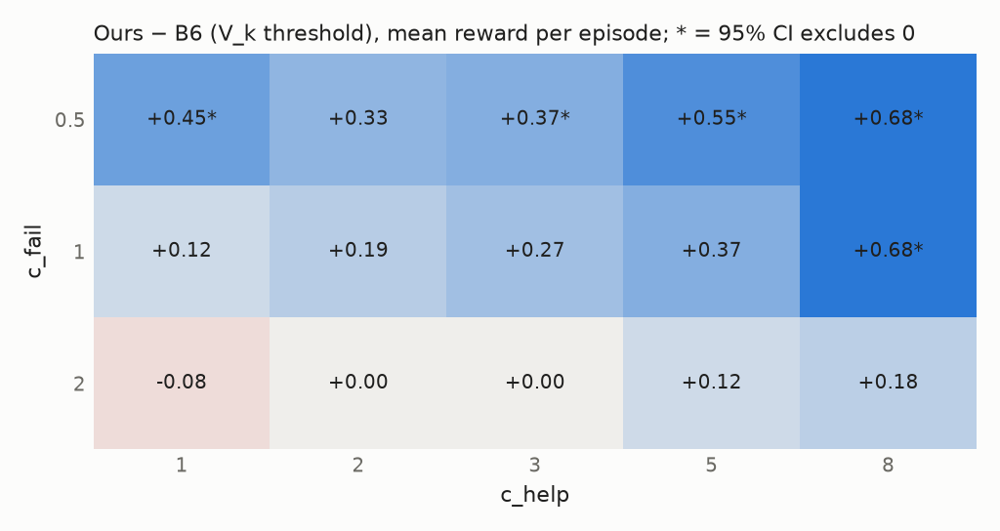
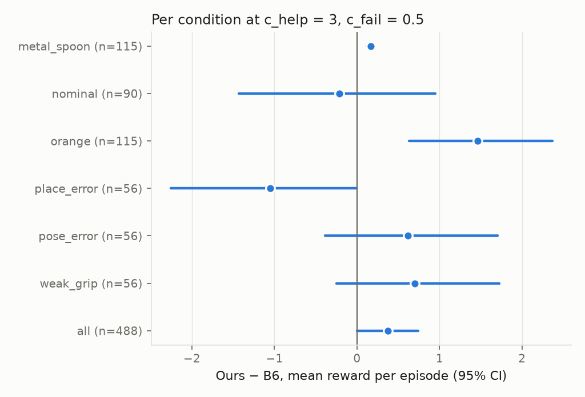

# Help-policy evaluation: expert trees

Folds (starts x conditions): {'train': 636, 'cal': 141, 'test': 488}. Test groups: {'metal_spoon': 115, 'nominal': 90, 'orange': 115, 'place_error': 56, 'pose_error': 56, 'weak_grip': 56}. Test difficulty: {'easy': 149, 'recoverable': 99, 'infeasible': 240}.

## Default costs (c_help = 3, c_fail = 0.5)

Tuned on cal: {'tau_B6': 0.06, 'tau_B5': 0.2, 'k_B3': 2, 'q_B4': 0.2337807606263982}

| method | reward (95% CI) | success | help | voluntary ask | fails/ep | off shelf | vol. ask prec. | vol. ask recall | regret | Ours − method (95% CI) |
|---|---|---|---|---|---|---|---|---|---|---|
| O2 clairvoyant | 3.49 [2.92, 4.06] | | | | | | | | 0 | -2.12 [-2.54, -1.72] |
| O1 difficulty oracle | 2.43 [1.85, 3.00] | 0.43 | 0.57 | 0.49 | 0.33 | 0.000 | 1.00 | 1.00 | 1.06 | -1.06 [-1.37, -0.76] |
| B8 QMDP | 1.38 [0.80, 1.97] | 0.38 | 0.62 | 0.44 | 0.88 | 0.012 | 0.90 | 0.81 | 2.11 | -0.01 [-0.13, +0.12] |
| A3 Ours, success/failure only | 1.37 [0.78, 1.96] | 0.37 | 0.63 | 0.45 | 0.83 | 0.012 | 0.88 | 0.80 | 2.11 | -0.00 [-0.16, +0.15] |
| Ours belief POMDP | 1.37 [0.77, 1.96] | 0.37 | 0.63 | 0.43 | 0.83 | 0.012 | 0.90 | 0.79 | 2.12 | — |
| B6 Vk threshold | 1.00 [0.43, 1.59] | 0.35 | 0.65 | 0.51 | 0.84 | 0.016 | 0.80 | 0.83 | 2.49 | +0.37 [+0.00, +0.74] |
| B5 V0 threshold | 0.99 [0.42, 1.56] | 0.34 | 0.66 | 0.40 | 0.76 | 0.016 | 0.83 | 0.68 | 2.50 | +0.38 [-0.02, +0.79] |
| B9 fitted Q | 0.93 [0.34, 1.53] | 0.35 | 0.65 | 0.42 | 1.21 | 0.014 | 0.87 | 0.74 | 2.56 | +0.44 [+0.21, +0.68] |
| B1 never ask | 0.60 [-0.02, 1.22] | 0.36 | 0.64 | 0.00 | 1.89 | 0.023 | 0.00 | 0.00 | 2.89 | +0.77 [+0.37, +1.17] |
| B7 myopic EU | 0.60 [-0.00, 1.21] | 0.36 | 0.64 | 0.00 | 1.89 | 0.023 | 0.00 | 0.00 | 2.89 | +0.77 [+0.36, +1.16] |
| B3 ask after k=2 | 0.59 [0.00, 1.18] | 0.33 | 0.67 | 0.60 | 1.32 | 0.018 | 0.75 | 0.92 | 2.90 | +0.78 [+0.44, +1.13] |
| A4 Ours, attempt only | 0.56 [-0.01, 1.14] | 0.32 | 0.68 | 0.40 | 0.98 | 0.010 | 0.92 | 0.75 | 2.93 | +0.81 [+0.52, +1.11] |
| A1 Ours, uniform prior | 0.23 [-0.36, 0.81] | 0.32 | 0.68 | 0.28 | 1.68 | 0.012 | 0.94 | 0.55 | 3.26 | +1.14 [+0.85, +1.45] |
| A2 Ours, frequency prior | 0.19 [-0.40, 0.78] | 0.31 | 0.69 | 0.38 | 1.52 | 0.010 | 0.89 | 0.68 | 3.30 | +1.19 [+0.89, +1.51] |
| B4 random at Ours's help rate | -0.24 [-0.69, 0.21] | 0.26 | 0.74 | 0.44 | 1.15 | 0.014 | 0.61 | 0.54 | 3.73 | +1.61 [+1.29, +1.95] |
| B2 always ask | -3.00 [-3.00, -3.00] | 0.00 | 1.00 | 1.00 | 0.00 | 0.000 | 0.49 | 1.00 | 6.49 | +4.37 [+3.77, +4.97] |

## Ours − B6 (V_k threshold) and Ours − best other non-oracle method, over the cost grid

| c_help | c_fail | Ours | B6 | Ours − B6 (95% CI) | best other | Ours − best other (95% CI) |
|---|---|---|---|---|---|---|
| 1 | 0.5 | 2.58 | 2.13 | +0.45 [+0.14, +0.76] | B8 QMDP (2.59) | -0.01 [-0.11, +0.10] |
| 1 | 1 | 2.05 | 1.93 | +0.12 [-0.15, +0.40] | B8 QMDP (2.04) | +0.01 [-0.11, +0.11] |
| 1 | 2 | 1.44 | 1.52 | -0.08 [-0.32, +0.16] | B8 QMDP (1.59) | -0.15 [-0.32, +0.00] |
| 2 | 0.5 | 1.98 | 1.65 | +0.33 [-0.01, +0.68] | B8 QMDP (1.99) | -0.01 [-0.12, +0.11] |
| 2 | 1 | 1.43 | 1.23 | +0.19 [-0.10, +0.50] | B8 QMDP (1.47) | -0.04 [-0.20, +0.11] |
| 2 | 2 | 0.83 | 0.83 | +0.00 [-0.26, +0.27] | B8 QMDP (0.87) | -0.03 [-0.17, +0.08] |
| 3 | 0.5 | 1.37 | 1.00 | +0.37 [+0.00, +0.74] | B8 QMDP (1.38) | -0.01 [-0.13, +0.12] |
| 3 | 1 | 0.81 | 0.54 | +0.27 [-0.07, +0.61] | B8 QMDP (0.82) | -0.01 [-0.17, +0.14] |
| 3 | 2 | 0.14 | 0.14 | +0.00 [-0.31, +0.30] | B8 QMDP (0.36) | -0.23 [-0.41, -0.07] |
| 5 | 0.5 | 0.11 | -0.44 | +0.55 [+0.11, +1.00] | B8 QMDP (0.13) | -0.02 [-0.16, +0.12] |
| 5 | 1 | -0.48 | -0.85 | +0.37 [-0.02, +0.77] | B8 QMDP (-0.37) | -0.11 [-0.31, +0.07] |
| 5 | 2 | -1.14 | -1.25 | +0.12 [-0.24, +0.48] | B8 QMDP (-1.00) | -0.14 [-0.34, +0.04] |
| 8 | 0.5 | -1.69 | -2.38 | +0.68 [+0.16, +1.21] | B8 QMDP (-1.80) | +0.11 [+0.02, +0.23] |
| 8 | 1 | -2.25 | -2.94 | +0.68 [+0.20, +1.19] | B8 QMDP (-2.27) | +0.02 [-0.13, +0.18] |
| 8 | 2 | -3.16 | -3.34 | +0.18 [-0.26, +0.62] | B8 QMDP (-3.13) | -0.03 [-0.24, +0.14] |

## Predictors on test (V_k: P(success | the default continuation))

| predictor | n | base rate | AUROC | Brier | NLL | ECE |
|---|---|---|---|---|---|---|
| V/in_distribution/k0 | 258 | 0.38 | 0.754 | 0.190 | 0.567 | 0.081 |
| V/in_distribution/k1 | 374 | 0.11 | 0.741 | 0.098 | 0.321 | 0.067 |
| V/in_distribution/k2 | 653 | 0.03 | 0.788 | 0.036 | 0.137 | 0.026 |
| V/orange/k0 | 115 | 0.67 | 0.735 | 0.306 | 0.806 | 0.365 |
| V/orange/k1 | 130 | 0.21 | 0.692 | 0.167 | 0.526 | 0.121 |
| V/orange/k2 | 186 | 0.06 | 0.750 | 0.053 | 0.203 | 0.042 |
| V/metal_spoon/k0 | 115 | 0.00 | nan | 0.005 | 0.067 | 0.064 |
| V/metal_spoon/k1 | 228 | 0.00 | nan | 0.001 | 0.026 | 0.026 |
| V/metal_spoon/k2 | 455 | 0.01 | 0.724 | 0.007 | 0.042 | 0.010 |

| difficulty head | n | accuracy | NLL | mean prior (easy, recoverable, infeasible) | true mix |
|---|---|---|---|---|---|
| difficulty/in_distribution | 258 | 0.64 | 0.888 | [0.303, 0.21, 0.487] | [0.298, 0.252, 0.45] |
| difficulty/orange | 115 | 0.17 | 1.217 | [0.218, 0.289, 0.493] | [0.626, 0.243, 0.13] |
| difficulty/metal_spoon | 115 | 0.95 | 0.290 | [0.029, 0.01, 0.961] | [0.0, 0.052, 0.948] |

