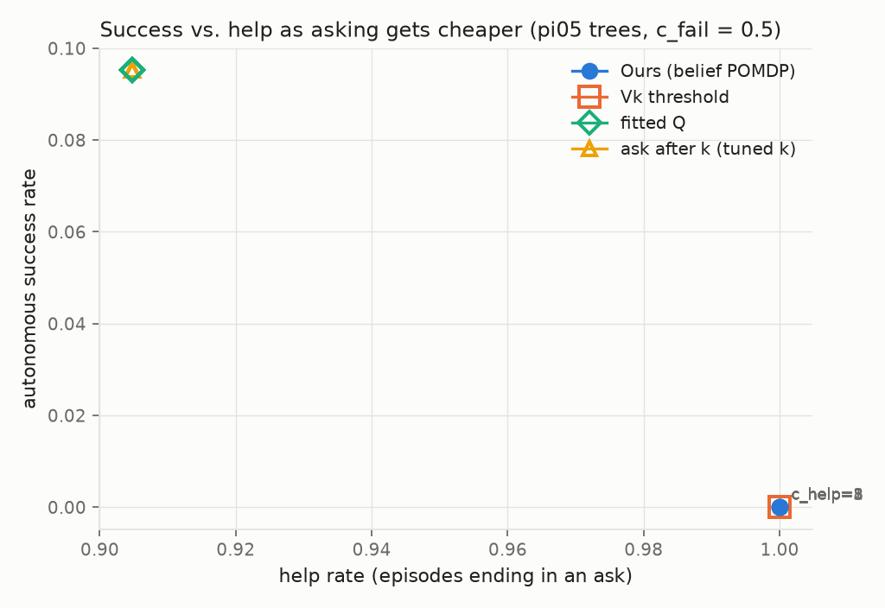
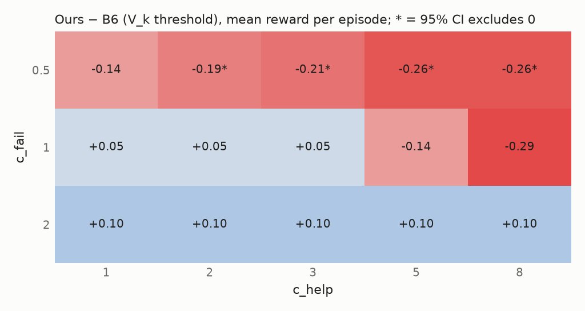
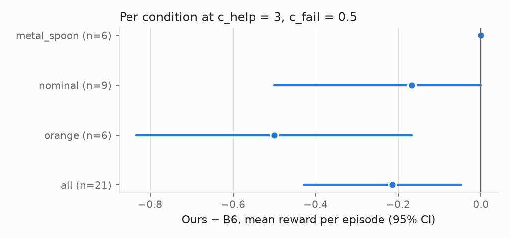
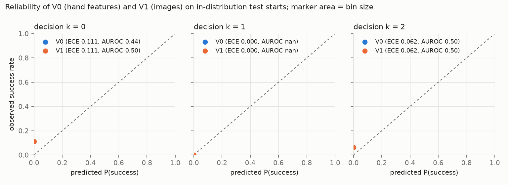

# Help-policy evaluation: pi05 trees

Folds (starts x conditions): {'train': 36, 'cal': 9, 'test': 21}. Test groups: {'metal_spoon': 6, 'nominal': 9, 'orange': 6}. Test difficulty: {'easy': 2, 'recoverable': 2, 'infeasible': 17}.

## Default costs (c_help = 3, c_fail = 0.5)

Tuned on cal: {"tau_B6'": 0.02, 'tau_B6': 0.02, 'tau_B5': 0.02, 'k_B3': 1, 'q_B4': 0.6451612903225806}

| method | reward (95% CI) | success | help | voluntary ask | fails/ep | off shelf | vol. ask prec. | vol. ask recall | regret | Ours − method (95% CI) |
|---|---|---|---|---|---|---|---|---|---|---|
| O2 clairvoyant | -0.62 [-2.43, 1.76] | | | | | | | | 0 | -2.62 [-4.98, -0.74] |
| O1 difficulty oracle | -1.90 [-3.21, 0.02] | 0.10 | 0.90 | 0.81 | 0.29 | 0.000 | 1.00 | 1.00 | 1.29 | -1.33 [-3.19, +0.00] |
| B9 fitted Q | -2.19 [-3.55, -0.24] | 0.10 | 0.90 | 0.90 | 0.86 | 0.000 | 0.89 | 1.00 | 1.57 | -1.05 [-2.93, +0.29] |
| B3 ask after k=1 | -2.21 [-3.50, -0.29] | 0.10 | 0.90 | 0.90 | 0.90 | 0.000 | 0.89 | 1.00 | 1.60 | -1.02 [-2.90, +0.33] |
| B4 random at Ours's help rate | -2.83 [-3.26, -2.18] | 0.03 | 0.97 | 0.92 | 0.45 | 0.000 | 0.83 | 0.94 | 2.21 | -0.41 [-1.04, +0.08] |
| A1 Ours, uniform prior | -2.83 [-4.24, -0.79] | 0.10 | 0.90 | 0.57 | 2.14 | 0.000 | 1.00 | 0.71 | 2.21 | -0.40 [-2.40, +0.98] |
| B2 always ask | -3.00 [-3.00, -3.00] | 0.00 | 1.00 | 1.00 | 0.00 | 0.000 | 0.81 | 1.00 | 2.38 | -0.24 [-0.45, -0.07] |
| A2 Ours, frequency prior | -3.00 [-3.00, -3.00] | 0.00 | 1.00 | 1.00 | 0.00 | 0.000 | 0.81 | 1.00 | 2.38 | -0.24 [-0.45, -0.07] |
| B6' V1_k threshold (images) | -3.00 [-3.00, -3.00] | 0.00 | 1.00 | 1.00 | 0.00 | 0.000 | 0.81 | 1.00 | 2.38 | -0.24 [-0.45, -0.05] |
| A5 Ours, image prior | -3.00 [-3.00, -3.00] | 0.00 | 1.00 | 1.00 | 0.00 | 0.000 | 0.81 | 1.00 | 2.38 | -0.24 [-0.45, -0.07] |
| B6 Vk threshold | -3.02 [-3.07, -3.00] | 0.00 | 1.00 | 1.00 | 0.05 | 0.000 | 0.81 | 1.00 | 2.40 | -0.21 [-0.43, -0.05] |
| B5 V0 threshold | -3.07 [-3.21, -3.00] | 0.00 | 1.00 | 0.95 | 0.14 | 0.000 | 0.80 | 0.94 | 2.45 | -0.17 [-0.40, +0.05] |
| B1 never ask | -3.12 [-4.50, -1.05] | 0.10 | 0.90 | 0.00 | 2.71 | 0.000 | 0.00 | 0.00 | 2.50 | -0.12 [-2.17, +1.33] |
| B7 myopic EU | -3.12 [-4.50, -1.05] | 0.10 | 0.90 | 0.00 | 2.71 | 0.000 | 0.00 | 0.00 | 2.50 | -0.12 [-2.19, +1.33] |
| B7' myopic EU, V1 | -3.12 [-4.50, -1.05] | 0.10 | 0.90 | 0.00 | 2.71 | 0.000 | 0.00 | 0.00 | 2.50 | -0.12 [-2.17, +1.33] |
| B8 QMDP | -3.24 [-3.45, -3.07] | 0.00 | 1.00 | 0.95 | 0.48 | 0.000 | 0.80 | 0.94 | 2.62 | +0.00 [+0.00, +0.00] |
| Ours belief POMDP | -3.24 [-3.45, -3.07] | 0.00 | 1.00 | 0.95 | 0.48 | 0.000 | 0.80 | 0.94 | 2.62 | — |
| A3 Ours, success/failure only | -3.24 [-3.43, -3.05] | 0.00 | 1.00 | 1.00 | 0.48 | 0.000 | 0.81 | 1.00 | 2.62 | +0.00 [-0.07, +0.07] |

## Ours − B6 (V_k threshold) and Ours − best other non-oracle method, over the cost grid

| c_help | c_fail | Ours | B6 | Ours − B6 (95% CI) | best other | Ours − best other (95% CI) |
|---|---|---|---|---|---|---|
| 1 | 0.5 | -1.17 | -1.02 | -0.14 [-0.29, +0.00] | B9 fitted Q (-0.33) | -0.83 [-2.45, +0.31] |
| 1 | 1 | -1.00 | -1.05 | +0.05 [+0.00, +0.14] | B9 fitted Q (-0.62) | -0.38 [-2.10, +0.90] |
| 1 | 2 | -1.00 | -1.10 | +0.10 [+0.00, +0.29] | B2 always ask (-1.00) | +0.00 [+0.00, +0.00] |
| 2 | 0.5 | -2.21 | -2.02 | -0.19 [-0.38, -0.05] | B9 fitted Q (-1.24) | -0.98 [-2.71, +0.24] |
| 2 | 1 | -2.00 | -2.05 | +0.05 [+0.00, +0.14] | B9 fitted Q (-1.52) | -0.48 [-2.33, +0.90] |
| 2 | 2 | -2.00 | -2.10 | +0.10 [+0.00, +0.29] | B2 always ask (-2.00) | +0.00 [+0.00, +0.00] |
| 3 | 0.5 | -3.24 | -3.02 | -0.21 [-0.43, -0.05] | B9 fitted Q (-2.19) | -1.05 [-2.93, +0.29] |
| 3 | 1 | -3.00 | -3.05 | +0.05 [+0.00, +0.14] | B9 fitted Q (-2.43) | -0.57 [-2.62, +0.90] |
| 3 | 2 | -3.00 | -3.10 | +0.10 [+0.00, +0.29] | B2 always ask (-3.00) | +0.00 [+0.00, +0.00] |
| 5 | 0.5 | -5.29 | -5.02 | -0.26 [-0.50, -0.07] | B9 fitted Q (-4.00) | -1.29 [-3.45, +0.24] |
| 5 | 1 | -5.19 | -5.05 | -0.14 [-0.43, +0.10] | B9 fitted Q (-4.33) | -0.86 [-3.14, +0.81] |
| 5 | 2 | -5.00 | -5.10 | +0.10 [+0.00, +0.29] | B2 always ask (-5.00) | +0.00 [+0.00, +0.00] |
| 8 | 0.5 | -8.29 | -8.02 | -0.26 [-0.50, -0.07] | B9 fitted Q (-6.71) | -1.57 [-4.17, +0.21] |
| 8 | 1 | -8.33 | -8.05 | -0.29 [-0.57, +0.00] | B9 fitted Q (-7.05) | -1.29 [-3.95, +0.62] |
| 8 | 2 | -8.00 | -8.10 | +0.10 [+0.00, +0.29] | B9 fitted Q (-7.52) | -0.48 [-3.33, +1.71] |

## Predictors on test (V_k: P(success | the default continuation); V0 hand features, V1 DINOv2 frames + proprioception + history)

| predictor | n | base rate | AUROC | Brier | NLL | ECE |
|---|---|---|---|---|---|---|
| V0/in_distribution/k0 | 9 | 0.11 | 0.438 | 0.111 | 1.535 | 0.111 |
| V0/in_distribution/k1 | 8 | 0.00 | nan | 0.000 | 0.000 | 0.000 |
| V0/in_distribution/k2 | 16 | 0.06 | 0.500 | 0.062 | 0.863 | 0.062 |
| V1/in_distribution/k0 | 9 | 0.11 | 0.500 | 0.111 | 1.535 | 0.111 |
| V1/in_distribution/k1 | 8 | 0.00 | nan | 0.000 | 0.000 | 0.000 |
| V1/in_distribution/k2 | 16 | 0.06 | 0.500 | 0.062 | 0.863 | 0.062 |
| V0/orange/k0 | 6 | 0.17 | 0.400 | 0.224 | 2.449 | 0.264 |
| V0/orange/k1 | 5 | 0.00 | nan | 0.000 | 0.000 | 0.000 |
| V0/orange/k2 | 10 | 0.10 | 0.500 | 0.100 | 1.382 | 0.100 |
| V1/orange/k0 | 6 | 0.17 | 0.500 | 0.167 | 2.303 | 0.167 |
| V1/orange/k1 | 5 | 0.00 | nan | 0.000 | 0.000 | 0.000 |
| V1/orange/k2 | 10 | 0.10 | 0.500 | 0.100 | 1.382 | 0.100 |
| V0/metal_spoon/k0 | 6 | 0.00 | nan | 0.000 | 0.000 | 0.000 |
| V0/metal_spoon/k1 | 6 | 0.00 | nan | 0.000 | 0.000 | 0.000 |
| V0/metal_spoon/k2 | 12 | 0.00 | nan | 0.000 | 0.000 | 0.000 |
| V1/metal_spoon/k0 | 6 | 0.00 | nan | 0.000 | 0.000 | 0.000 |
| V1/metal_spoon/k1 | 6 | 0.00 | nan | 0.000 | 0.000 | 0.000 |
| V1/metal_spoon/k2 | 12 | 0.00 | nan | 0.000 | 0.000 | 0.000 |

| difficulty head | n | accuracy | NLL | mean prior (easy, recoverable, infeasible) | true mix |
|---|---|---|---|---|---|
| difficulty/in_distribution | 9 | 0.78 | 1.413 | [0.013, 0.039, 0.948] | [0.111, 0.111, 0.778] |
| difficulty_img/in_distribution | 9 | 0.78 | 1.316 | [0.009, 0.011, 0.98] | [0.111, 0.111, 0.778] |
| difficulty/orange | 6 | 0.67 | 0.929 | [0.018, 0.145, 0.837] | [0.167, 0.167, 0.667] |
| difficulty_img/orange | 6 | 0.67 | 1.483 | [0.009, 0.013, 0.978] | [0.167, 0.167, 0.667] |
| difficulty/metal_spoon | 6 | 1.00 | 0.000 | [0.0, 0.0, 1.0] | [0.0, 0.0, 1.0] |
| difficulty_img/metal_spoon | 6 | 1.00 | 0.083 | [0.003, 0.076, 0.921] | [0.0, 0.0, 1.0] |

