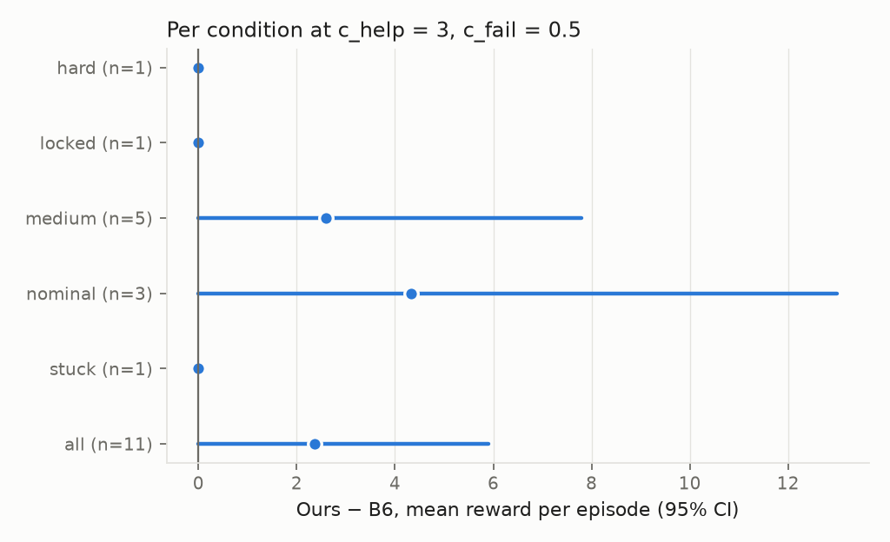

# Help-policy evaluation: drawer trees

Folds (starts x conditions): {'train': 14, 'cal': 5, 'test': 11}. Test groups: {'hard': 1, 'locked': 1, 'medium': 5, 'nominal': 3, 'stuck': 1}. Test difficulty: {'easy': 2, 'recoverable': 7, 'infeasible': 2}.

## Default costs (c_help = 3, c_fail = 0.5)

Tuned on cal: {'tau_B6': 0.28, 'tau_B5': 0.0, 'k_B3': 1, 'q_B4': 0.0}

| method | reward (95% CI) | success | help | voluntary ask | fails/ep | off shelf | vol. ask prec. | vol. ask recall | regret | Ours − method (95% CI) |
|---|---|---|---|---|---|---|---|---|---|---|
| O2 clairvoyant | 7.23 [3.86, 9.59] | | | | | | | | 0 | -0.27 [-0.68, +0.00] |
| B9 fitted Q | 7.00 [3.27, 9.59] | 0.82 | 0.18 | 0.09 | 1.27 | 0.000 | 1.00 | 0.50 | 0.23 | -0.05 [-0.14, +0.00] |
| B1 never ask | 6.95 [3.14, 9.59] | 0.82 | 0.18 | 0.00 | 1.36 | 0.000 | 0.00 | 0.00 | 0.27 | +0.00 [+0.00, +0.00] |
| B5 V0 threshold | 6.95 [3.18, 9.59] | 0.82 | 0.18 | 0.00 | 1.36 | 0.000 | 0.00 | 0.00 | 0.27 | +0.00 [+0.00, +0.00] |
| B7 myopic EU | 6.95 [3.18, 9.59] | 0.82 | 0.18 | 0.00 | 1.36 | 0.000 | 0.00 | 0.00 | 0.27 | +0.00 [+0.00, +0.00] |
| B8 QMDP | 6.95 [3.18, 9.59] | 0.82 | 0.18 | 0.00 | 1.36 | 0.000 | 0.00 | 0.00 | 0.27 | +0.00 [+0.00, +0.00] |
| Ours belief POMDP | 6.95 [3.14, 9.59] | 0.82 | 0.18 | 0.00 | 1.36 | 0.000 | 0.00 | 0.00 | 0.27 | — |
| A1 Ours, uniform prior | 6.95 [3.14, 9.59] | 0.82 | 0.18 | 0.00 | 1.36 | 0.000 | 0.00 | 0.00 | 0.27 | +0.00 [+0.00, +0.00] |
| A2 Ours, frequency prior | 6.95 [3.18, 9.59] | 0.82 | 0.18 | 0.00 | 1.36 | 0.000 | 0.00 | 0.00 | 0.27 | +0.00 [+0.00, +0.00] |
| A3 Ours, success/failure only | 6.95 [3.18, 9.55] | 0.82 | 0.18 | 0.00 | 1.36 | 0.000 | 0.00 | 0.00 | 0.27 | +0.00 [+0.00, +0.00] |
| O1 difficulty oracle | 6.95 [3.14, 9.55] | 0.82 | 0.18 | 0.00 | 1.36 | 0.000 | 0.00 | 0.00 | 0.27 | +0.00 [+0.00, +0.00] |
| B4 random at Ours's help rate | 6.95 [3.14, 9.59] | 0.82 | 0.18 | 0.00 | 1.36 | 0.000 | 0.00 | 0.00 | 0.27 | +0.00 [+0.00, +0.00] |
| B6 Vk threshold | 4.59 [0.77, 8.41] | 0.64 | 0.36 | 0.18 | 1.36 | 0.000 | 0.00 | 0.00 | 2.64 | +2.36 [+0.00, +5.91] |
| B3 ask after k=1 | -1.05 [-3.50, 2.64] | 0.18 | 0.82 | 0.82 | 0.82 | 0.000 | 0.22 | 1.00 | 8.27 | +8.00 [+4.27, +11.68] |
| B2 always ask | -3.00 [-3.00, -3.00] | 0.00 | 1.00 | 1.00 | 0.00 | 0.000 | 0.18 | 1.00 | 10.23 | +9.95 [+6.14, +12.59] |

## Ours − B6 (V_k threshold) and Ours − best other non-oracle method, over the cost grid

| c_help | c_fail | Ours | B6 | Ours − B6 (95% CI) | best other | Ours − best other (95% CI) |
|---|---|---|---|---|---|---|
| 1 | 0.5 | 7.32 | 5.32 | +2.00 [+0.00, +5.00] | B9 fitted Q (7.36) | -0.05 [-0.14, +0.00] |
| 1 | 1 | 6.64 | 4.64 | +2.00 [+0.00, +5.00] | B9 fitted Q (6.82) | -0.18 [-0.45, +0.00] |
| 1 | 2 | 5.27 | 3.27 | +2.00 [+0.00, +5.00] | B9 fitted Q (5.64) | -0.36 [-0.91, +0.00] |
| 2 | 0.5 | 7.14 | 4.95 | +2.18 [+0.00, +5.45] | B9 fitted Q (7.18) | -0.05 [-0.14, +0.00] |
| 2 | 1 | 6.45 | 4.27 | +2.18 [+0.00, +5.45] | B9 fitted Q (6.64) | -0.18 [-0.45, +0.00] |
| 2 | 2 | 5.09 | 2.91 | +2.18 [+0.00, +5.45] | B9 fitted Q (5.45) | -0.36 [-0.91, +0.00] |
| 3 | 0.5 | 6.95 | 4.59 | +2.36 [+0.00, +5.91] | B9 fitted Q (7.00) | -0.05 [-0.14, +0.00] |
| 3 | 1 | 6.27 | 3.91 | +2.36 [+0.00, +5.91] | B9 fitted Q (6.45) | -0.18 [-0.45, +0.00] |
| 3 | 2 | 4.91 | 2.55 | +2.36 [+0.00, +5.91] | B9 fitted Q (5.27) | -0.36 [-0.91, +0.00] |
| 5 | 0.5 | 6.59 | 3.86 | +2.73 [+0.00, +6.82] | B9 fitted Q (6.64) | -0.05 [-0.14, +0.00] |
| 5 | 1 | 5.91 | 3.18 | +2.73 [+0.00, +6.82] | B9 fitted Q (6.09) | -0.18 [-0.45, +0.00] |
| 5 | 2 | 4.55 | 1.82 | +2.73 [+0.00, +6.82] | B9 fitted Q (4.91) | -0.36 [-0.91, +0.00] |
| 8 | 0.5 | 6.05 | 2.77 | +3.27 [+0.00, +8.18] | B9 fitted Q (6.09) | -0.05 [-0.14, +0.00] |
| 8 | 1 | 5.36 | 2.09 | +3.27 [+0.00, +8.18] | B9 fitted Q (5.55) | -0.18 [-0.45, +0.00] |
| 8 | 2 | 4.00 | 0.73 | +3.27 [+0.00, +8.18] | B9 fitted Q (4.36) | -0.36 [-0.91, +0.00] |

## Predictors on test (V_k: P(success | the default continuation); V0 hand features, V1 DINOv2 frames + proprioception + history)

| predictor | n | base rate | AUROC | Brier | NLL | ECE |
|---|---|---|---|---|---|---|
| V0/in_distribution/k0 | 6 | 0.83 | 0.500 | 0.398 | 1.003 | 0.509 |
| V0/in_distribution/k1 | 5 | 0.80 | 1.000 | 0.380 | 0.966 | 0.483 |
| V0/in_distribution/k2 | 2 | 0.50 | 0.000 | 0.472 | 1.454 | 0.614 |

| difficulty head | n | accuracy | NLL | mean prior (easy, recoverable, infeasible) | true mix |
|---|---|---|---|---|---|
| difficulty/in_distribution | 6 | 0.17 | 1.207 | [0.5, 0.286, 0.214] | [0.167, 0.667, 0.167] |

