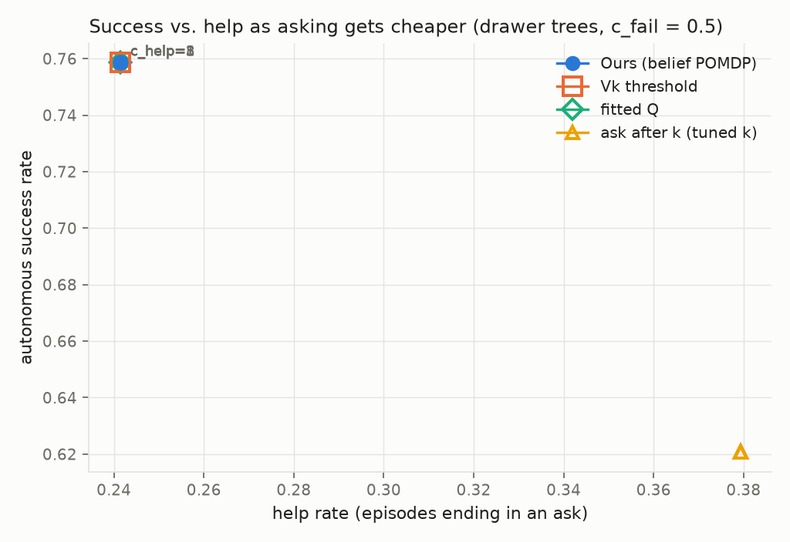
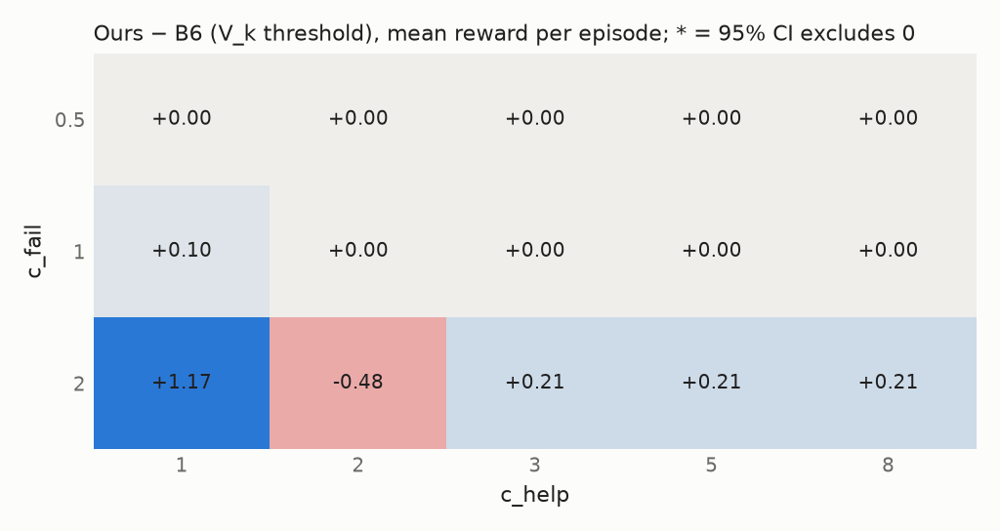

# Help-policy evaluation: drawer trees

Folds (starts x conditions): {'train': 37, 'cal': 9, 'test': 29}. Test groups: {'hard': 4, 'locked': 3, 'medium': 13, 'nominal': 5, 'stuck': 4}. Test difficulty: {'easy': 10, 'recoverable': 12, 'infeasible': 7}.

## Default costs (c_help = 3, c_fail = 0.5)

Tuned on cal: {'tau_B6': 0.0, 'tau_B5': 0.0, 'k_B3': 2, 'q_B4': 0.0}

| method | reward (95% CI) | success | help | voluntary ask | fails/ep | off shelf | vol. ask prec. | vol. ask recall | regret | Ours − method (95% CI) |
|---|---|---|---|---|---|---|---|---|---|---|
| O1 difficulty oracle | 6.59 [4.47, 8.38] | 0.76 | 0.24 | 0.24 | 0.55 | 0.000 | 1.00 | 1.00 | 0.00 | -0.36 [-0.62, -0.16] |
| O2 clairvoyant | 6.59 [4.43, 8.38] | | | | | | | | 0 | -0.36 [-0.62, -0.16] |
| B9 fitted Q | 6.28 [3.91, 8.24] | 0.76 | 0.24 | 0.10 | 1.17 | 0.000 | 1.00 | 0.43 | 0.31 | -0.05 [-0.12, +0.00] |
| B1 never ask | 6.22 [3.83, 8.26] | 0.76 | 0.24 | 0.00 | 1.28 | 0.000 | 0.00 | 0.00 | 0.36 | +0.00 [+0.00, +0.00] |
| B5 V0 threshold | 6.22 [3.83, 8.22] | 0.76 | 0.24 | 0.00 | 1.28 | 0.000 | 0.00 | 0.00 | 0.36 | +0.00 [+0.00, +0.00] |
| B6 Vk threshold | 6.22 [3.81, 8.22] | 0.76 | 0.24 | 0.00 | 1.28 | 0.000 | 0.00 | 0.00 | 0.36 | +0.00 [+0.00, +0.00] |
| B7 myopic EU | 6.22 [3.81, 8.22] | 0.76 | 0.24 | 0.00 | 1.28 | 0.000 | 0.00 | 0.00 | 0.36 | +0.00 [+0.00, +0.00] |
| B8 QMDP | 6.22 [3.83, 8.24] | 0.76 | 0.24 | 0.00 | 1.28 | 0.000 | 0.00 | 0.00 | 0.36 | +0.00 [+0.00, +0.00] |
| Ours belief POMDP | 6.22 [3.79, 8.22] | 0.76 | 0.24 | 0.00 | 1.28 | 0.000 | 0.00 | 0.00 | 0.36 | — |
| A1 Ours, uniform prior | 6.22 [3.83, 8.21] | 0.76 | 0.24 | 0.00 | 1.28 | 0.000 | 0.00 | 0.00 | 0.36 | +0.00 [+0.00, +0.00] |
| A2 Ours, frequency prior | 6.22 [3.83, 8.24] | 0.76 | 0.24 | 0.00 | 1.28 | 0.000 | 0.00 | 0.00 | 0.36 | +0.00 [+0.00, +0.00] |
| A3 Ours, success/failure only | 6.22 [3.83, 8.22] | 0.76 | 0.24 | 0.00 | 1.28 | 0.000 | 0.00 | 0.00 | 0.36 | +0.00 [+0.00, +0.00] |
| B4 random at Ours's help rate | 6.22 [3.84, 8.22] | 0.76 | 0.24 | 0.00 | 1.28 | 0.000 | 0.00 | 0.00 | 0.36 | +0.00 [+0.00, +0.00] |
| B3 ask after k=2 | 4.55 [2.16, 6.91] | 0.62 | 0.38 | 0.38 | 1.03 | 0.000 | 0.64 | 1.00 | 2.03 | +1.67 [+0.28, +3.48] |
| B2 always ask | -3.00 [-3.00, -3.00] | 0.00 | 1.00 | 1.00 | 0.00 | 0.000 | 0.24 | 1.00 | 9.59 | +9.22 [+6.81, +11.22] |

## Ours − B6 (V_k threshold) and Ours − best other non-oracle method, over the cost grid

| c_help | c_fail | Ours | B6 | Ours − B6 (95% CI) | best other | Ours − best other (95% CI) |
|---|---|---|---|---|---|---|
| 1 | 0.5 | 6.71 | 6.71 | +0.00 [+0.00, +0.00] | B9 fitted Q (6.76) | -0.05 [-0.10, +0.00] |
| 1 | 1 | 6.17 | 6.07 | +0.10 [+0.00, +0.24] | B8 QMDP (6.17) | +0.00 [+0.00, +0.00] |
| 1 | 2 | 4.38 | 3.21 | +1.17 [-0.17, +2.76] | B9 fitted Q (5.00) | -0.62 [-1.83, +0.28] |
| 2 | 0.5 | 6.47 | 6.47 | +0.00 [+0.00, +0.00] | B9 fitted Q (6.52) | -0.05 [-0.12, +0.00] |
| 2 | 1 | 5.83 | 5.83 | +0.00 [+0.00, +0.00] | B9 fitted Q (5.93) | -0.10 [-0.21, +0.00] |
| 2 | 2 | 4.07 | 4.55 | -0.48 [-1.79, +0.48] | B9 fitted Q (4.76) | -0.69 [-2.00, +0.28] |
| 3 | 0.5 | 6.22 | 6.22 | +0.00 [+0.00, +0.00] | B9 fitted Q (6.28) | -0.05 [-0.12, +0.00] |
| 3 | 1 | 5.59 | 5.59 | +0.00 [+0.00, +0.00] | B9 fitted Q (5.69) | -0.10 [-0.24, +0.00] |
| 3 | 2 | 4.52 | 4.31 | +0.21 [+0.00, +0.48] | B8 QMDP (4.52) | +0.00 [+0.00, +0.00] |
| 5 | 0.5 | 5.74 | 5.74 | +0.00 [+0.00, +0.00] | B9 fitted Q (5.79) | -0.05 [-0.12, +0.00] |
| 5 | 1 | 5.10 | 5.10 | +0.00 [+0.00, +0.00] | B9 fitted Q (5.21) | -0.10 [-0.24, +0.00] |
| 5 | 2 | 4.03 | 3.83 | +0.21 [+0.00, +0.48] | B8 QMDP (4.03) | +0.00 [+0.00, +0.00] |
| 8 | 0.5 | 5.02 | 5.02 | +0.00 [+0.00, +0.00] | B9 fitted Q (5.07) | -0.05 [-0.12, +0.00] |
| 8 | 1 | 4.38 | 4.38 | +0.00 [+0.00, +0.00] | B9 fitted Q (4.48) | -0.10 [-0.24, +0.00] |
| 8 | 2 | 3.31 | 3.10 | +0.21 [+0.00, +0.48] | B8 QMDP (3.31) | +0.00 [+0.00, +0.00] |

## Predictors on test (V_k: P(success | the default continuation); V0 hand features, V1 DINOv2 frames + proprioception + history)

| predictor | n | base rate | AUROC | Brier | NLL | ECE |
|---|---|---|---|---|---|---|
| V0/in_distribution/k0 | 16 | 0.69 | 0.500 | 0.227 | 0.647 | 0.110 |
| V0/in_distribution/k1 | 11 | 0.55 | 0.333 | 0.241 | 0.672 | 0.131 |
| V0/in_distribution/k2 | 7 | 0.29 | 0.500 | 0.136 | 0.436 | 0.102 |

| difficulty head | n | accuracy | NLL | mean prior (easy, recoverable, infeasible) | true mix |
|---|---|---|---|---|---|
| difficulty/in_distribution | 16 | 0.31 | 1.105 | [0.27, 0.351, 0.378] | [0.312, 0.375, 0.312] |

